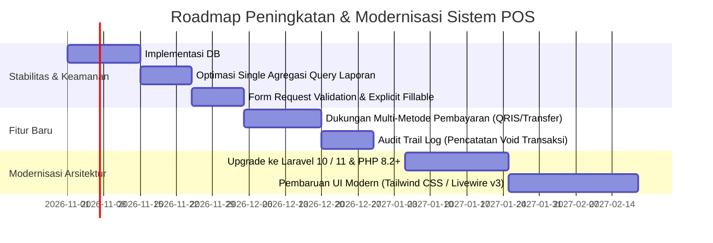

# Analisis Kualitas Kode & Rekomendasi Peningkatan

Dokumen ini menyajikan hasil audit teknis, analisis arsitektur, evaluasi keamanan, serta rekomendasi perbaikan untuk meningkatkan keandalan, keamanan, dan skalabilitas **Aplikasi Point of Sales (POS)**.

---

## 1. Analisis Kekuatan Sistem (*Strengths*)

1. **Pemisahan Peran yang Jelas**:
   Implementasi middleware `CekLevel` membatasi akses modul sensitif (pengaturan keuangan, laba/rugi, manajemen stok) hanya kepada Administrator, sementara kasir diarahkan langsung ke antarmuka POS.
2. **Kinerja DataTables Server-Side**:
   Penggunaan `yajra/laravel-datatables-oracle` mencegah overload memori browser saat memuat ribuan data transaksi penjualan, produk, dan log pengeluaran.
3. **Fleksibilitas Pencetakan Multi-Format**:
   Penyediaan dua format struk (Thermal Struk 58mm/80mm untuk printer POS kasir dan Dokumen PDF A4 untuk faktur resmi) sangat cocok untuk berbagai skenario bisnis ritel maupun grosir.
4. **Helper Utility Lokal Terpusat**:
   Fungsi konversi rupiah (`format_uang`), ejaan bilangan (`terbilang`), tanggal lokal (`tanggal_indonesia`), dan auto-padding kode (`tambah_nol_didepan`) tersusun rapi di `app/Http/Helpers/helpers.php` dan digunakan secara konsisten.

---

## 2. Temuan Kritis & Area Peningkatan (*Critical Findings*)

### 2.1. Ketiadaan Transaksi Database Atomik (`DB::transaction`)
- **Lokasi**: [PenjualanController.php (metode `store`)](file:///c:/Dev/Projects/Tutorial-Buat-POS/app/Http/Controllers/PenjualanController.php#L76-L98) dan [PembelianController.php (metode `store`)](file:///c:/Dev/Projects/Tutorial-Buat-POS/app/Http/Controllers/PembelianController.php#L73-L95).
- **Masalah**:
  Saat menyimpan transaksi, pembaruan status faktur dilakukan terlebih dahulu, kemudian stok produk dikurangi/ditambah di dalam loop `foreach`. Jika terjadi kegagalan sistem, crash koneksi, atau duplikasi data di tengah-tengah loop:
  - Header transaksi sudah tersimpan.
  - Sebagian stok produk terpotong, sedangkan produk lainnya belum terpotong.
- **Rekomendasi Solusi**:
  Bungkus operasi database dalam closure `DB::transaction` agar ACID compliant:
  ```php
  use Illuminate\Support\Facades\DB;

  public function store(Request $request)
  {
      DB::transaction(function () use ($request) {
          $penjualan = Penjualan::findOrFail($request->id_penjualan);
          $penjualan->update([...]);

          $detail = PenjualanDetail::where('id_penjualan', $penjualan->id_penjualan)->get();
          foreach ($detail as $item) {
              $produk = Produk::lockForUpdate()->find($item->id_produk);
              if ($produk->stok < $item->jumlah) {
                  throw new \Exception("Stok produk {$produk->nama_produk} tidak mencukupi!");
              }
              $produk->stok -= $item->jumlah;
              $produk->save();
          }
      });

      return redirect()->route('transaksi.selesai');
  }
  ```

---

### 2.2. Pola Query N+1 pada Perhitungan Laporan
- **Lokasi**: [LaporanController.php (metode `getData`)](file:///c:/Dev/Projects/Tutorial-Buat-POS/app/Http/Controllers/LaporanController.php#L26-L65).
- **Masalah**:
  Sistem mengeksekusi 3 query database (`Penjualan::sum`, `Pembelian::sum`, `Pengeluaran::sum`) di dalam iterasi per hari `while (strtotime($awal) <= strtotime($akhir))`.
  - Jika pengguna memilih rentang laporan selama 1 tahun (365 hari), aplikasi akan menjalankan:
    $$3 \times 365 = 1.095 \text{ kali query database!}$$
  Hal ini dapat menyebabkan *timeout* atau pemborosan resource CPU database server.
- **Rekomendasi Solusi**:
  Gunakan agregasi SQL berbasis `GROUP BY DATE(created_at)` tunggal:
  ```php
  $penjualan = Penjualan::selectRaw('DATE(created_at) as tgl, SUM(bayar) as total')
      ->whereBetween('created_at', [$awal . ' 00:00:00', $akhir . ' 23:59:59'])
      ->groupBy('tgl')
      ->pluck('total', 'tgl');
  // Lakukan hal yang sama untuk pembelian & pengeluaran, lalu gabungkan di memori PHP.
  ```

---

### 2.3. Validasi Permintaan Masukan (*Mass Assignment & Validation*)
- **Lokasi**: Model Eloquent menggunakan `$guarded = []` dan Controller memanggil `$request->all()`.
- **Masalah**:
  Tidak adanya validasi input yang ketat berpotensi menimbulkan *mass-assignment vulnerability* bila ada field yang disuntikkan dari formulir eksternal. Selain itu, input kuantitas belum divalidasi apakah berupa angka positif atau melebihi sisa stok fisik.
- **Rekomendasi Solusi**:
  1. Manfaatkan **Form Request Validation** (contoh: `StoreProdukRequest`).
  2. Definisikan array `$fillable` eksplisit pada setiap model Eloquent, hindari `$guarded = []`.

---

### 2.4. Pencegahan Stok Minus (*Inventory Underflow*)
- **Lokasi**: [PenjualanDetailController.php](file:///c:/Dev/Projects/Tutorial-Buat-POS/app/Http/Controllers/PenjualanDetailController.php).
- **Masalah**:
  Saat kasir menambahkan produk ke keranjang atau memperbarui kuantitas pembelian, tidak ada validasi apakah `jumlah` melampaui sisa `stok`. Stok produk bisa menjadi negatif di database jika kasir salah mengetik jumlah.
- **Rekomendasi Solusi**:
  Tambahkan validasi stok pada endpoint pembaruan kuantitas (`update` & `store`):
  ```php
  if ($request->jumlah > $produk->stok) {
      return response()->json(['message' => 'Kuantitas melebihi sisa stok yang tersedia.'], 422);
  }
  ```

---

## 3. Rencana Pengembangan ke Depan (*Roadmap*)



| Prioritas | Item Peningkatan | Dampak Bisnis |
| :---: | :--- | :--- |
| **P0 (Kritis)** | Pembungkusan `DB::transaction` pada penjualan & pembelian | Mencegah inkonsistensi stok dan data finansial gantung |
| **P0 (Kritis)** | Validasi sisa stok sebelum checkout kasir | Menghindari penjualan fiktif atas stok kosong (stok minus) |
| **P1 (Tinggi)** | Optimasi query agregasi laporan laba/rugi | Meningkatkan kecepatan loading laporan tahunan dari puluhan detik menjadi instan |
| **P2 (Sedang)** | Integrasi metode pembayaran digital (QRIS / EDC) | Memperluas opsi pembayaran pelanggan modern |
| **P3 (Rendah)** | Upgrade bertahap ke Laravel versi LTS terbaru | Menjaga kompatibilitas keamanan dan performa PHP generasi baru |
