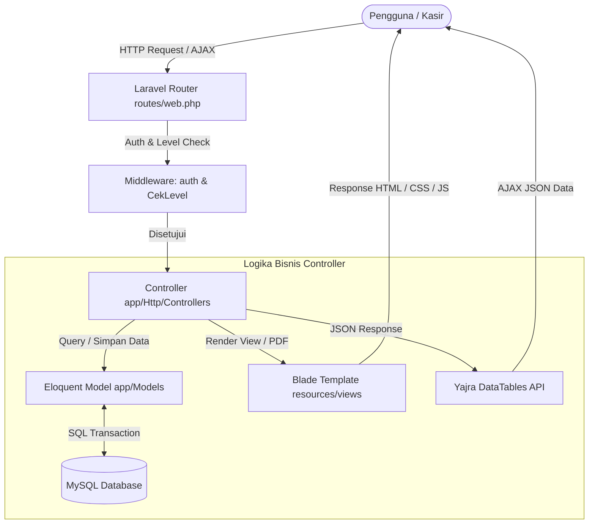

# Arsitektur & Teknologi Sistem POS

Dokumen ini menjelaskan arsitektur teknis, dependensi pihak ketiga, struktur folder, dan pola desain yang digunakan pada **Aplikasi Point of Sales (POS)**.

---

## 1. Spesifikasi Teknologi

| Komponen | Teknologi | Keterangan |
| :--- | :--- | :--- |
| **Backend Framework** | [Laravel 8.12+](https://laravel.com) | Framework PHP MVC modern dengan routing, ORM Eloquent, dan middleware |
| **Bahasa Pemrograman** | PHP ^7.3 / ^8.0 | Kompatibel dengan PHP 7.4 dan PHP 8.0 |
| **Database** | MySQL / MariaDB (InnoDB) | Mendukung relasi referensial dan foreign key |
| **UI & Layout** | AdminLTE v2.4 | Framework Bootstrap 3.3.7 dengan styling responsif |
| **Tabel & Data Grid** | [Yajra Datatables](https://yajrabox.com) v9.0 | Server-side processing untuk pencarian, sorting, dan pagination cepat |
| **PDF Rendering** | [barryvdh/laravel-dompdf](https://github.com/barryvdh/laravel-dompdf) v0.9 | Render HTML ke PDF untuk Nota Besar, Laporan Laba/Rugi, Kartu Member, dan Barcode |
| **Barcode Generator** | [milon/barcode](https://github.com/milon/barcode) v8.0 | Pembuatan barcode DNS1D (Code 128 / Code 39) untuk label produk dan kartu member |
| **Visualisasi Grafik** | ChartJS v2 | Grafik visualisasi pendapatan harian/bulanan di dashboard administrator |
| **Autentikasi** | Laravel Jetstream + Fortify | Manajemen sesi login, logout, dan proteksi rute |

---

## 2. Struktur Modul & Dependensi Composer

Berdasarkan [composer.json](file:///c:/Dev/Projects/Tutorial-Buat-POS/composer.json):

```json
"require": {
    "php": "^7.3|^8.0",
    "barryvdh/laravel-dompdf": "^0.9.0",
    "doctrine/dbal": "^3.0",
    "fideloper/proxy": "^4.4",
    "fruitcake/laravel-cors": "^2.0",
    "guzzlehttp/guzzle": "^7.0.1",
    "laravel/framework": "^8.12",
    "laravel/jetstream": "^2.2",
    "laravel/sanctum": "^2.6",
    "laravel/tinker": "^2.5",
    "livewire/livewire": "^2.0",
    "milon/barcode": "^8.0",
    "yajra/laravel-datatables-oracle": "~9.0"
}
```

---

## 3. Pola Desain & Alur Request (MVC Pattern)

Aplikasi mengimplementasikan pola **Model-View-Controller (MVC)** standar Laravel:



### 3.1. Routing & Otorisasi Rute
Daftar rute utama didefinisikan pada [routes/web.php](file:///c:/Dev/Projects/Tutorial-Buat-POS/routes/web.php) dengan pembagian middleware group:

1. **Grup Bebas**:
   - `/` $\rightarrow$ Redirect otomatis ke halaman login.
2. **Grup `auth`**:
   - `/dashboard` $\rightarrow$ Mengarahkan tampilan sesuai role (admin melihat grafik & ringkasan, kasir melihat welcome banner).
3. **Grup `middleware => ['auth', 'level:1']` (Khusus Administrator)**:
   - Modul Master Kategori (`/kategori`, `/kategori/data`)
   - Modul Master Produk (`/produk`, `/produk/data`, `/produk/delete-selected`, `/produk/cetak-barcode`)
   - Modul Master Member (`/member`, `/member/data`, `/member/cetak-member`)
   - Modul Master Supplier (`/supplier`, `/supplier/data`)
   - Modul Transaksi Pengeluaran (`/pengeluaran`, `/pengeluaran/data`)
   - Modul Transaksi Pembelian Stok (`/pembelian`, `/pembelian_detail`)
   - Modul Riwayat Penjualan Seluruh Kasir (`/penjualan`, `/penjualan/data`, `/penjualan/{id}`)
   - Modul Laporan Pendapatan (`/laporan`, `/laporan/data/{awal}/{akhir}`, `/laporan/pdf/{awal}/{akhir}`)
   - Modul Manajemen Pengguna (`/user`, `/user/data`)
   - Modul Pengaturan Toko (`/setting`, `/setting/first`)
4. **Grup `middleware => ['auth', 'level:1,2']` (Administrator & Kasir)**:
   - Transaksi Kasir Baru (`/transaksi/baru`, `/transaksi/simpan`)
   - Antarmuka Kasir POS (`/transaksi`, `/transaksi/loadform`, `/transaksi/{id}/data`)
   - Halaman Transaksi Selesai & Cetak Nota (`/transaksi/selesai`, `/transaksi/nota-kecil`, `/transaksi/nota-besar`)
   - Profil User (`/profil`, `/profil/update`)

---

## 4. Middleware & Kontrol Akses Berbasis Peran (RBAC)

Sistem menggunakan class middleware [App\Http\Middleware\CekLevel](file:///c:/Dev/Projects/Tutorial-Buat-POS/app/Http/Middleware/CekLevel.php):

- Di-alias sebagai `level` pada kernel HTTP Laravel.
- Menerima parameter dinamis variadic `...$level`.
- Pengecekan dilakukan terhadap kolom `level` pada tabel `users`:
  - `1`: **Administrator**
  - `2`: **Kasir**
- Jika user tidak memiliki level yang sesuai, request dialihkan kembali ke rute `dashboard`.

---

## 5. Helper Global (`helpers.php`)

Aplikasi mendefinisikan beberapa helper kustom yang di-autoload lewat composer pada [app/Http/Helpers/helpers.php](file:///c:/Dev/Projects/Tutorial-Buat-POS/app/Http/Helpers/helpers.php):

1. **`format_uang($angka)`**: Memformat integer menjadi string rupiah standar Indonesia (contoh: `10000` $\rightarrow$ `10.000`).
2. **`terbilang($angka)`**: Mengonversi nominal numerik menjadi kalimat bahasa Indonesia untuk keperluan cetak nota (contoh: `15000` $\rightarrow$ `"lima belas ribu"`).
3. **`tanggal_indonesia($tgl, $tampil_hari = true)`**: Mengubah tanggal format SQL `YYYY-MM-DD` ke format nama hari dan bulan bahasa Indonesia.
4. **`tambah_nol_didepan($value, $threshold)`**: Membuat padding nol di depan digit angka (contoh: id `2` dengan threshold `5` menjadi `00002`) untuk standarisasi kode member dan kode barcode produk.

---

## 6. Direktori Penting Proyek

```
Tutorial-Buat-POS/
├── app/
│   ├── Http/
│   │   ├── Controllers/       # Controller logika bisnis (13 controller)
│   │   ├── Helpers/           # helpers.php fungsi utility global
│   │   └── Middleware/        # CekLevel.php dan middleware auth
│   └── Models/                # Eloquent ORM Models (11 model)
├── database/
│   ├── migrations/            # Skema tabel database (21 migrasi)
│   └── seeders/               # Data dummy awal akun dan setting toko
├── docs/                      # Dokumentasi komprehensif proyek
├── public/
│   ├── AdminLTE-2/            # Asset template AdminLTE, Bootstrap, Plugins
│   └── img/                   # Logo toko, gambar kartu member, foto profil
├── resources/
│   └── views/                 # Blade templates tampilan sistem (19 folder view)
├── routes/
│   └── web.php                # Definisi rute antarmuka dan API internal
└── composer.json              # Definisi dependensi paket PHP
```
