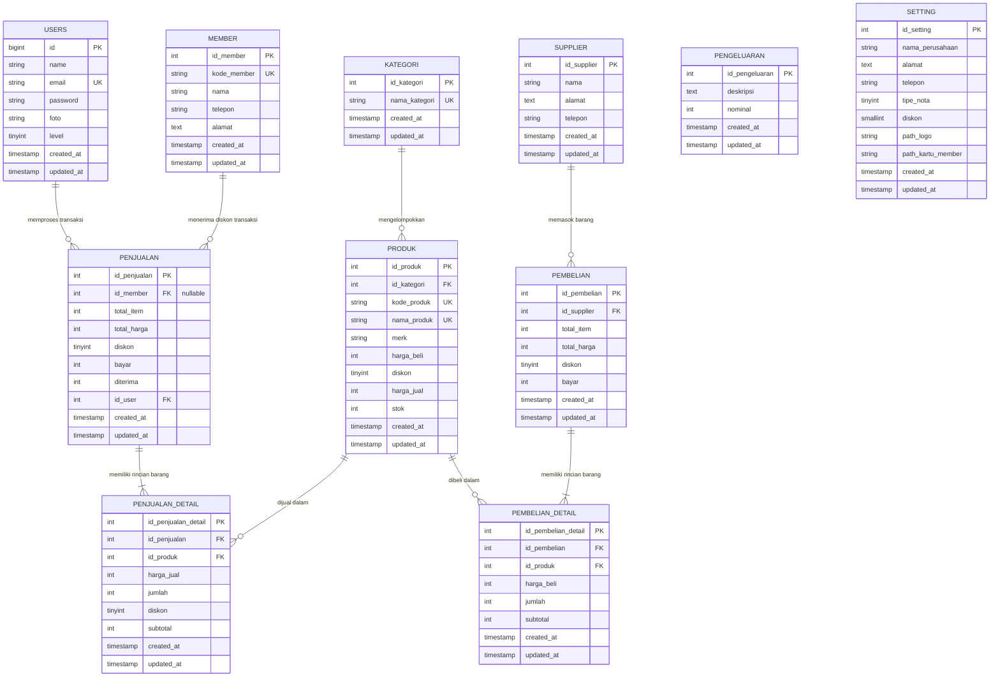

# Basis Data & Relasi (Database Schema & ERD)

Dokumen ini memaparkan struktur tabel, tipe data, indeks, relasi antar entitas, serta Entity Relationship Diagram (ERD) dari **Aplikasi Point of Sales (POS)**.

---

## 1. Entity Relationship Diagram (ERD)

Berikut adalah diagram relasi entitas pada sistem POS:



---

## 2. Kamus Data & Spesifikasi Tabel

### 2.1. Tabel `users`
Menyimpan kredensial dan hak akses pengguna sistem (Admin & Kasir).

| Kolom | Tipe Data | Nullable | Keterangan |
| :--- | :--- | :--- | :--- |
| `id` | BIGINT UNSIGNED | NO | Primary Key (Auto Increment) |
| `name` | VARCHAR(255) | NO | Nama lengkap pengguna |
| `email` | VARCHAR(255) | NO | Email akun (Unique) |
| `password` | VARCHAR(255) | NO | Hash Bcrypt password |
| `foto` | VARCHAR(255) | YES | Path foto profil pengguna (default `/img/user.jpg`) |
| `level` | TINYINT | NO | Tingkatan akses (`1` = Administrator, `2` = Kasir) |
| `created_at` / `updated_at` | TIMESTAMP | YES | Waktu pembuatan & modifikasi |

---

### 2.2. Tabel `kategori`
Kategori klasifikasi untuk pengelompokan produk dagangan.

| Kolom | Tipe Data | Nullable | Keterangan |
| :--- | :--- | :--- | :--- |
| `id_kategori` | INT UNSIGNED | NO | Primary Key (Auto Increment) |
| `nama_kategori` | VARCHAR(255) | NO | Nama kategori (Unique) |
| `created_at` / `updated_at` | TIMESTAMP | YES | Waktu audit |

---

### 2.3. Tabel `produk`
Katalog barang dagangan yang diperjualbelikan.

| Kolom | Tipe Data | Nullable | Keterangan |
| :--- | :--- | :--- | :--- |
| `id_produk` | INT UNSIGNED | NO | Primary Key (Auto Increment) |
| `id_kategori` | INT UNSIGNED | NO | Foreign Key ke `kategori.id_kategori` |
| `kode_produk` | VARCHAR(255) | NO | Kode unik produk untuk barcode (Unique, contoh: `P000001`) |
| `nama_produk` | VARCHAR(255) | NO | Nama barang / produk (Unique) |
| `merk` | VARCHAR(255) | YES | Brand / Merk produk |
| `harga_beli` | INT | NO | Harga modal / harga beli dari supplier |
| `diskon` | TINYINT | NO | Diskon khusus produk dalam satuan persen (%) |
| `harga_jual` | INT | NO | Harga retail yang ditawarkan ke konsumen |
| `stok` | INT | NO | Sisa jumlah kuantitas stok barang |
| `created_at` / `updated_at` | TIMESTAMP | YES | Waktu audit |

---

### 2.4. Tabel `member`
Data pelanggan setia yang berhak mendapatkan diskon transaksi.

| Kolom | Tipe Data | Nullable | Keterangan |
| :--- | :--- | :--- | :--- |
| `id_member` | INT UNSIGNED | NO | Primary Key (Auto Increment) |
| `kode_member` | VARCHAR(255) | NO | Kode kartu member (Unique, contoh: `00001`) |
| `nama` | VARCHAR(255) | NO | Nama lengkap member |
| `telepon` | VARCHAR(255) | NO | Nomor kontak member |
| `alamat` | TEXT | YES | Alamat domisili member |
| `created_at` / `updated_at` | TIMESTAMP | YES | Waktu audit |

---

### 2.5. Tabel `supplier`
Data vendor atau pemasok stok barang ke toko.

| Kolom | Tipe Data | Nullable | Keterangan |
| :--- | :--- | :--- | :--- |
| `id_supplier` | INT UNSIGNED | NO | Primary Key (Auto Increment) |
| `nama` | VARCHAR(255) | NO | Nama supplier / badan usaha |
| `alamat` | TEXT | YES | Alamat kantor / gudang supplier |
| `telepon` | VARCHAR(255) | NO | Nomor telepon kontak |
| `created_at` / `updated_at` | TIMESTAMP | YES | Waktu audit |

---

### 2.6. Tabel `pembelian` & `pembelian_detail`
Mencatat faktur transaksi kulakan/restock barang dari supplier.

**Header (`pembelian`):**
| Kolom | Tipe Data | Nullable | Keterangan |
| :--- | :--- | :--- | :--- |
| `id_pembelian` | INT UNSIGNED | NO | Primary Key (Auto Increment) |
| `id_supplier` | INT | NO | Foreign Key ke `supplier.id_supplier` |
| `total_item` | INT | NO | Total kuantitas barang yang dibeli |
| `total_harga` | INT | NO | Akumulasi subtotal harga sebelum diskon faktur |
| `diskon` | TINYINT | NO | Diskon faktur pembelian (%) |
| `bayar` | INT | NO | Nominal akhir yang dibayarkan ke supplier |

**Detail (`pembelian_detail`):**
| Kolom | Tipe Data | Nullable | Keterangan |
| :--- | :--- | :--- | :--- |
| `id_pembelian_detail` | INT UNSIGNED | NO | Primary Key (Auto Increment) |
| `id_pembelian` | INT | NO | Foreign Key ke `pembelian.id_pembelian` |
| `id_produk` | INT | NO | Foreign Key ke `produk.id_produk` |
| `harga_beli` | INT | NO | Harga satuan beli saat transaksi berlangsung |
| `jumlah` | INT | NO | Kuantitas barang yang dibeli (menambah stok produk) |
| `subtotal` | INT | NO | `harga_beli * jumlah` |

---

### 2.7. Tabel `penjualan` & `penjualan_detail`
Mencatat transaksi penjualan kasir (Point of Sales).

**Header (`penjualan`):**
| Kolom | Tipe Data | Nullable | Keterangan |
| :--- | :--- | :--- | :--- |
| `id_penjualan` | INT UNSIGNED | NO | Primary Key (Auto Increment) |
| `id_member` | INT | YES | FK ke `member.id_member` (opsional jika bukan member) |
| `total_item` | INT | NO | Total unit barang yang dibeli pelanggan |
| `total_harga` | INT | NO | Total belanja sebelum diskon member |
| `diskon` | TINYINT | NO | Persentase diskon member (%) |
| `bayar` | INT | NO | Nominal tagihan bersih yang wajib dibayar |
| `diterima` | INT | NO | Uang tunai yang diserahkan pelanggan |
| `id_user` | INT | NO | Foreign Key ke `users.id` (kasir yang bertugas) |

**Detail (`penjualan_detail`):**
| Kolom | Tipe Data | Nullable | Keterangan |
| :--- | :--- | :--- | :--- |
| `id_penjualan_detail` | INT UNSIGNED | NO | Primary Key (Auto Increment) |
| `id_penjualan` | INT | NO | Foreign Key ke `penjualan.id_penjualan` |
| `id_produk` | INT | NO | Foreign Key ke `produk.id_produk` |
| `harga_jual` | INT | NO | Harga satuan jual saat transaksi |
| `jumlah` | INT | NO | Kuantitas produk (mengurangi stok produk) |
| `diskon` | TINYINT | NO | Persentase diskon per produk |
| `subtotal` | INT | NO | Nominal subtotal setelah dikurangi diskon |

---

### 2.8. Tabel `pengeluaran`
Mencatat biaya operasional toko di luar pembelian barang (seperti listrik, air, sewa, gaji harian).

| Kolom | Tipe Data | Nullable | Keterangan |
| :--- | :--- | :--- | :--- |
| `id_pengeluaran` | INT UNSIGNED | NO | Primary Key (Auto Increment) |
| `deskripsi` | TEXT | NO | Rincian keperluan pengeluaran |
| `nominal` | INT | NO | Jumlah uang kas yang dikeluarkan (Rupiah) |

---

### 2.9. Tabel `setting`
Menyimpan preferensi dan konfigurasi toko secara terpusat (hanya terdapat 1 record).

| Kolom | Tipe Data | Nullable | Keterangan |
| :--- | :--- | :--- | :--- |
| `id_setting` | INT UNSIGNED | NO | Primary Key |
| `nama_perusahaan` | VARCHAR(255) | NO | Nama toko / bisnis |
| `alamat` | TEXT | YES | Alamat toko yang tertera pada nota |
| `telepon` | VARCHAR(255) | NO | Kontak telepon toko |
| `tipe_nota` | TINYINT | NO | Pilihan nota default (`1` = Nota Kecil / Thermal, `2` = Nota Besar / Faktur PDF) |
| `diskon` | SMALLINT | NO | Nilai persentase potongan default untuk member setia |
| `path_logo` | VARCHAR(255) | YES | Path file logo toko |
| `path_kartu_member` | VARCHAR(255) | YES | Path background kartu member untuk pencetakan PDF |

---

## 3. Relasi Model Eloquent Laravel

Setiap model pada direktori `app/Models/` mendefinisikan relasi Eloquent:

```php
// App\Models\Produk
public function kategori() {
    return $this->belongsTo(Kategori::class, 'id_kategori', 'id_kategori');
}

// App\Models\Pembelian
public function supplier() {
    return $this->belongsTo(Supplier::class, 'id_supplier', 'id_supplier');
}

// App\Models\Penjualan
public function member() {
    return $this->belongsTo(Member::class, 'id_member', 'id_member');
}
public function user() {
    return $this->belongsTo(User::class, 'id_user', 'id');
}

// App\Models\PenjualanDetail
public function produk() {
    return $this->belongsTo(Produk::class, 'id_produk', 'id_produk');
}
```

> [!NOTE]
> Semua primary key kustom di model Eloquent menggunakan konfigurasi explicit:
> `$table->primaryKey = 'id_[nama_tabel]';` dan `$table->guarded = [];`.
