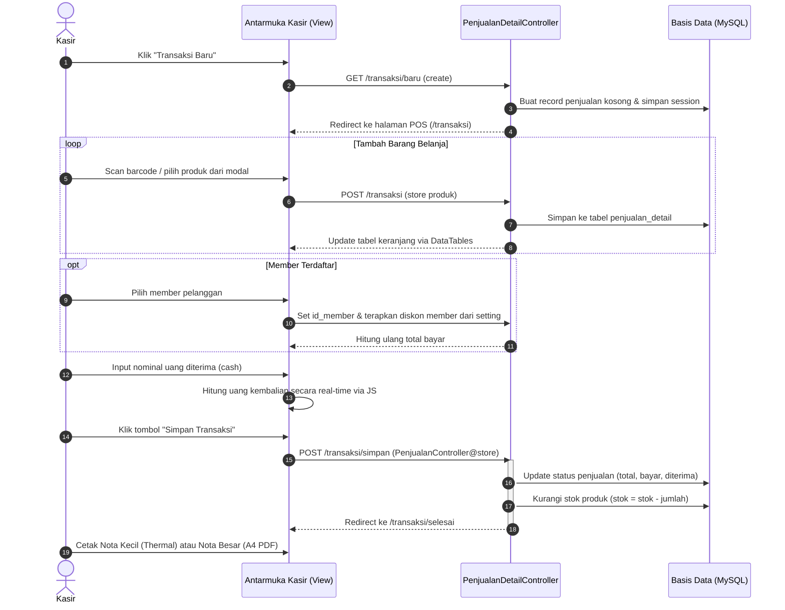
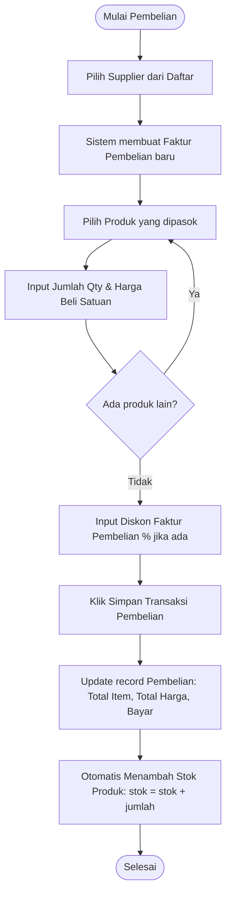
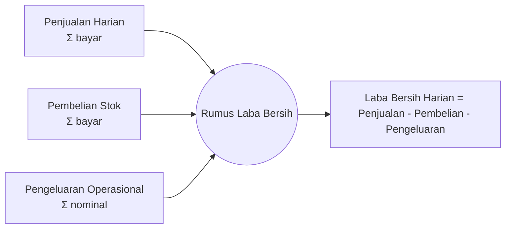

# Fitur & Alur Bisnis (Business Logic & Workflows)

Dokumen ini menguraikan seluruh modul fungsional, logika bisnis inti, serta diagram alur proses kerja (**business workflow**) pada **Aplikasi Point of Sales (POS)**.

---

## 1. Matriks Hak Akses Pengguna (RBAC Matrix)

Sistem membedakan dua tingkatan hak akses pengguna:

| Modul / Menu | Aksi / Fitur | Administrator (Level 1) | Kasir (Level 2) |
| :--- | :--- | :---: | :---: |
| **Dashboard** | Statistik box + Grafik Penjualan bulanan | ✅ | ❌ *(Welcome view)* |
| **Master Kategori** | Lihat, Tambah, Edit, Hapus Kategori | ✅ | ❌ |
| **Master Produk** | CRUD Produk, Multiple Delete, Cetak Barcode | ✅ | ❌ |
| **Master Member** | CRUD Member, Cetak Kartu Member PDF | ✅ | ❌ |
| **Master Supplier** | CRUD Data Supplier / Vendor | ✅ | ❌ |
| **Pengeluaran** | Catat biaya operasional & utilitas toko | ✅ | ❌ |
| **Pembelian (Restock)** | Beli stok dari supplier, hitung faktur | ✅ | ❌ |
| **Penjualan (Kasir POS)** | Input transaksi penjualan baru | ✅ | ✅ |
| **Cetak Nota** | Cetak Struk Kasir (Kecil/Thermal) & Nota Besar | ✅ | ✅ |
| **Riwayat Penjualan** | Lihat semua riwayat, detail, & hapus transaksi | ✅ | ❌ |
| **Laporan Pendapatan** | Rekap Laba/Rugi, Filter Tanggal, Ekspor PDF | ✅ | ❌ |
| **Manajemen User** | Tambah kasir, atur role & password | ✅ | ❌ |
| **Pengaturan Toko** | Ganti nama toko, alamat, diskon member, logo | ✅ | ❌ |
| **Profil Pribadi** | Ubah nama, password, dan foto profil | ✅ | ✅ |

---

## 2. Alur Transaksi Penjualan Kasir (POS Workflow)

Proses penjualan kasir dirancang cepat (*fast checkout*) untuk meminimalkan antrean di kasir:

### Logika Khusus Penjualan:
1. **Pencegahan Data Yatim**: Record `penjualan` dibuat saat membuka form transaksi baru, lalu `id_penjualan` disimpan pada `session('id_penjualan')`.
2. **Kalkulasi Subtotal**:
   $$\text{Subtotal Produk} = (\text{Harga Jual} \times \text{Jumlah}) - \left(\frac{\text{Diskon Produk}}{100} \times \text{Harga Jual} \times \text{Jumlah}\right)$$
3. **Kalkulasi Total Akhir & Diskon Member**:
   $$\text{Total Bayar} = \sum \text{Subtotal} - \left(\frac{\text{Diskon Member}}{100} \times \sum \text{Subtotal}\right)$$
4. **Pemberian Kembalian**:
   $$\text{Kembalian} = \text{Uang Diterima} - \text{Total Bayar}$$
5. **Dukungan Struk**:
   - **Nota Kecil (58mm/80mm)**: View Blade khusus dengan style CSS `@media print` untuk printer struk thermal POS.
   - **Nota Besar**: Menggunakan library DomPDF dengan ukuran kertas khusus custom portrait (`609x440pt`).

---

## 3. Alur Pengadaan Stok Barang (Pembelian / Restock)

Alur pembelian digunakan saat toko memesan atau menerima pasokan barang dari supplier:

---

## 4. Alur Perhitungan Laporan Keuangan (Laba / Rugi)

Modul laporan pendapatan (`LaporanController`) merekapitulasi performa finansial harian dan bulanan secara dinamis.

### Karakteristik Laporan:
- **Rentang Fleksibel**: Secara default menampilkan tanggal 1 s/d hari ini pada bulan berjalan, atau rentang tanggal kustom yang ditentukan pengguna.
- **Akumulasi Menyeluruh**: Menampilkan subtotal penjualan, pembelian, pengeluaran, dan pendapatan bersih harian serta total agregat di baris terakhir.
- **Ekspor Dokumen**: Hasil rekapitulasi dapat dicetak langsung ke format PDF standar cetak dokumen A4.

---

## 5. Fitur Otomatisasi & Nilai Tambah

### 5.1. Cetak Barcode Produk Terpilih
- Memilih satu atau beberapa produk sekaligus menggunakan checkbox DataTables.
- Mengenerate barcode Code 128 / Code 39 melalui package `milon/barcode`.
- Diformat rapi dalam grid 3 kolom per baris siap potong untuk stiker label harga rak atau kemasan barang.

### 5.2. Cetak Kartu Member Pelanggan
- Memilih data member yang akan dicetak kartunya.
- Merender sisi depan (logo perusahaan & identitas) dan sisi belakang (barcode kartu member & syarat ketentuan).
- Ukuran layout PDF disesuaikan dengan dimensi standar kartu PVC (kartu ATM/ID Card).

### 5.3. Pengaturan Toko Terpusat
- Administrator dapat mengubah nama toko, alamat, dan nomor kontak yang secara otomatis tertera di header seluruh struk belanja dan faktur.
- Mengunggah logo toko dan desain background kartu member.
- Menentukan persentase diskon member otomatis dan preferensi jenis nota default.
